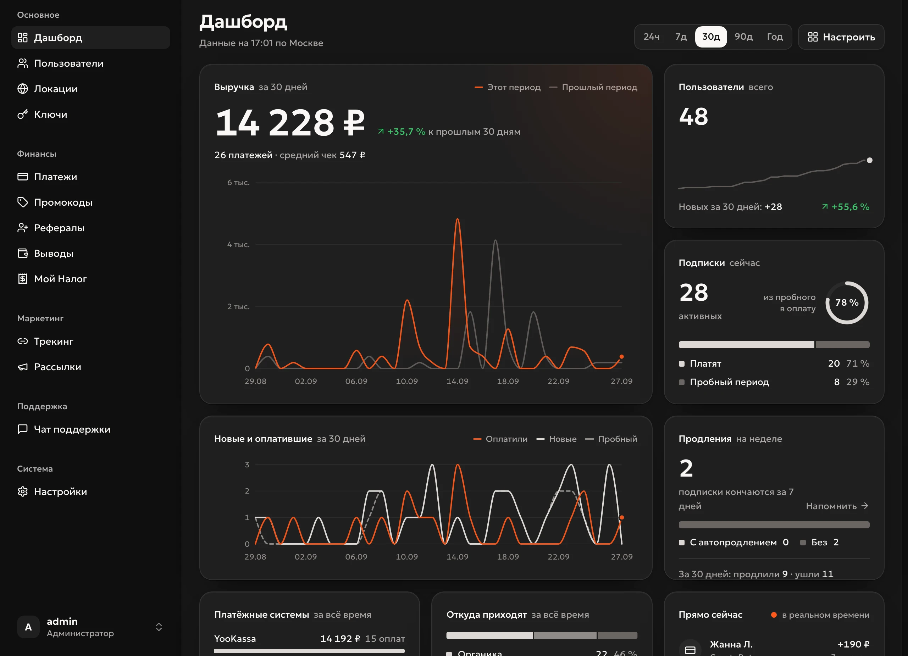
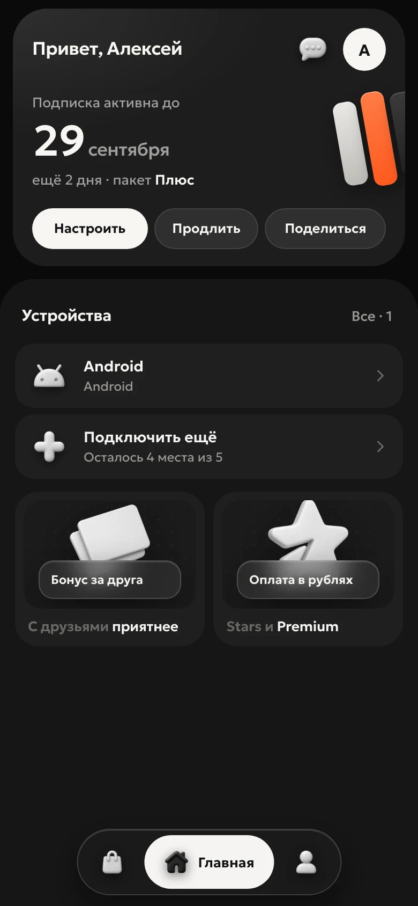
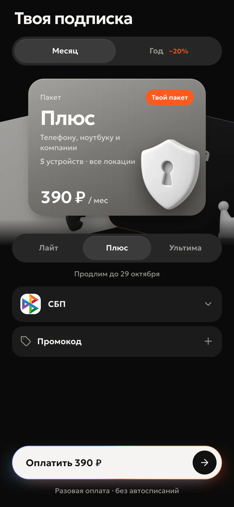

<div align="center">
  <h1>Reefox Panel</h1>
  <p><strong>A platform for selling VPN subscriptions on top of 3x-ui.</strong><br>
  Telegram bot, Mini App, a website with a customer cabinet, payments and an admin panel. One command installs it on your server.</p>
  <p>
    <a href="https://reefox.ru">Website</a> ·
    <a href="https://docs.reefox.ru">Docs (Russian)</a> ·
    <a href="https://t.me/reefox_store_bot">7-day trial key</a> ·
    <a href="README.md">Русский</a>
  </p>
</div>

<p align="center"></p>

Reefox Panel runs on your server under your brand. Customers buy a subscription in the bot, the Mini App or on the website and get one link with all your locations. Your customer base and your payments stay with you.

This repository is the project's storefront. The source code is closed; the build is delivered for a valid license key. The interface is in Russian and the payment providers are built for the Russian market.

## What's inside

**Sales**
- Lite, Plus and Ultima packages, each with its own device count, price and traffic limit. Monthly or yearly billing, with a discount you set.
- A trial, once per account, with the days and package you choose.
- Payments through YooKassa, Platega and CryptoBot: SBP, cards, crypto, international cards, ERIP. Telegram Stars in the Mini App. Every method has a fallback provider.
- «Мой Налог» receipts for self-employed sellers, created after every payment.
- Promo codes, referrals and ad links with stats from click to payment.
- Broadcasts by audience, with images and on a schedule. Renewal reminders in the bot and by email.

**Customers**
- Bot and Mini App in Telegram.
- A website with a cabinet: email sign-in, payment and renewal without Telegram.
- One subscription link for Happ, INCY, v2RayTun and Karing.
- Split routing: Russian sites go direct, outside the VPN.

**Servers**
- 3x-ui servers connected over SSH: the platform finds the panel and creates clients itself.
- VLESS with Reality, XHTTP, WebSocket, gRPC and HTTPUpgrade; Hysteria2.
- Several servers per location, customers balanced automatically.
- Own Xray without 3x-ui (beta): VLESS and Hysteria2 installed for you, with a "Russian entry → foreign exits" cascade.
- Checks from Russia: if a server stops opening you get a message and keys move to a working server in the same location.
- An "Availability" page (beta): see which mobile operator's customers lost a server.

**Administration**
- A live admin panel: new customers, payments and messages appear on their own.
- Support chat and an AI assistant for replies.
- Separate addresses for the admin panel, the customer site and subscription links.
- Scheduled, encrypted database backups to Telegram or S3.
- Credentials for servers, payment providers and bots are encrypted at rest.
- One-click updates. If a new version fails to start, the previous one comes back by itself.
- Built-in move to a new server.

<p align="center">
  
  
</p>

## Requirements

- **A server for the platform:** Ubuntu 22.04/24.04 or Debian 12, x86-64, root over SSH. 2 vCPU, 2 GB RAM and 20 GB disk recommended. Ports 80 and 443 open.
- **Telegram must be reachable from it** (api.telegram.org).
- **A domain** with an A record to the server. In Cloudflare, DNS only (grey cloud).
- **A bot from @BotFather** and your Telegram ID.
- **Servers running 3x-ui 3.x**, separate from the platform server, with SSH access.
- **A license key.** A 7-day trial key comes from [@reefox_store_bot](https://t.me/reefox_store_bot).

## Install

```bash
curl -fsSL https://store.reefox.ru/install.sh -o install.sh && sudo bash install.sh
```

The installer asks five questions (license key, domain, bot token, your Telegram ID, an email for the certificate) and checks each answer before installing anything. Then it sets up Docker, the database, the web server and HTTPS on its own, usually in 5–10 minutes. When it is done, the bot sends you a link to the admin panel.

## Support

- Questions and help with setup: [@by_monexo](https://t.me/by_monexo)
- Report a vulnerability: [SECURITY.md](SECURITY.md)

## License

Proprietary software, see [LICENSE](LICENSE). Release history: [CHANGELOG.md](CHANGELOG.md) (in Russian).
