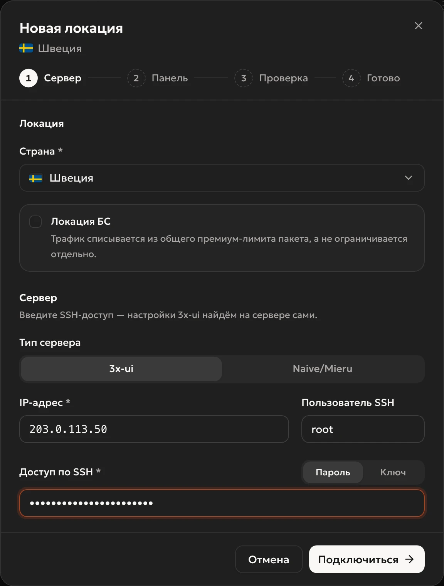
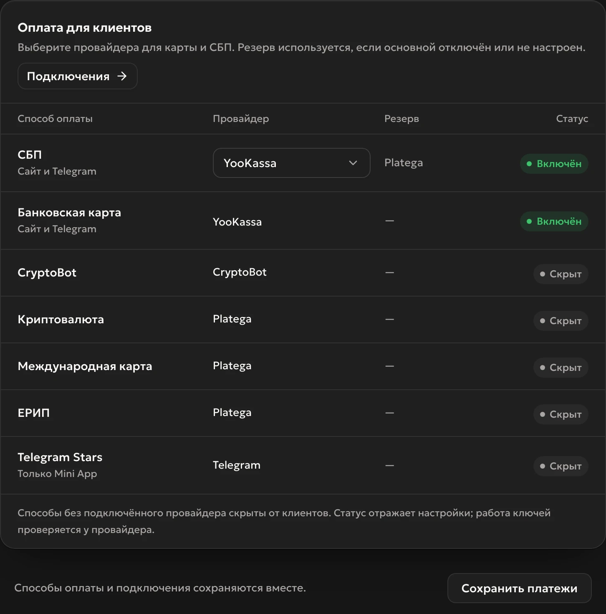

<div align="center">
  <h1>Reefox Panel</h1>
  <p><strong>Платформа для продажи VPN-подписок поверх 3x-ui.</strong><br>
  Telegram-бот, Mini App, сайт с кабинетом, оплаты и админка. Ставится на ваш сервер одной командой.</p>
  <p>
    <a href="https://reefox.ru">Сайт</a> ·
    <a href="https://docs.reefox.ru">Документация</a> ·
    <a href="https://t.me/reefox_store_bot">Пробный ключ на 7 дней</a> ·
    <a href="README.en.md">English</a>
  </p>
</div>

<p align="center"></p>

Reefox Panel работает на вашем сервере и под вашим брендом. Клиенты покупают подписку в боте, в Mini App или на сайте и получают одну ссылку со всеми вашими локациями. База клиентов и деньги от оплат остаются у вас.

Это витрина проекта. Исходный код закрыт, сборка выдаётся по ключу лицензии.

## Что внутри

**Продажи**
- Пакеты Лайт, Плюс и Ультима: своё число устройств, цена и лимит трафика. Оплата за месяц или за год со скидкой, которую задаёте вы.
- Пробный период: один раз на аккаунт, число дней и пакет настраиваются.
- Оплата через ЮKassa, Platega и CryptoBot: СБП, карты, криптовалюта, международные карты, ЕРИП. Telegram Stars в Mini App. У каждого способа есть резервный провайдер.
- «Мой Налог» для самозанятых: чек создаётся сам после каждой оплаты.
- Промокоды, реферальная программа, рекламные ссылки со статистикой от перехода до оплаты.
- Рассылки по аудиториям, с картинкой и по расписанию. Напоминания о продлении в боте и по почте.

**Клиенты**
- Бот и Mini App в Telegram.
- Сайт с кабинетом: вход по почте, оплата и продление без Telegram.
- Одна ссылка подписки для Happ, INCY, v2RayTun и Karing.
- Раздельная маршрутизация: российские сайты открываются напрямую, мимо VPN.

**Серверы**
- Подключение серверов 3x-ui по SSH: платформа сама находит панель и создаёт клиентов.
- VLESS с Reality, XHTTP, WebSocket, gRPC и HTTPUpgrade, Hysteria2.
- Несколько серверов в одной локации, клиенты распределяются автоматически.
- Свой Xray без 3x-ui (бета): VLESS и Hysteria2 ставятся сами, есть каскад «вход в России → выходы за рубежом».
- Проверка из России: если сервер перестал открываться, придёт сообщение, а ключи перейдут на рабочий сервер той же локации.
- Страница «Доступность» (бета): видно, у клиентов какого оператора перестал открываться сервер.

**Администрирование**
- Админка в реальном времени: новые клиенты, оплаты и сообщения появляются сами.
- Чат поддержки и ИИ-помощник для ответов клиентам.
- Отдельные адреса для админки, клиентского сайта и ссылок подписки.
- Резервные копии базы по расписанию, зашифрованные, в Telegram или S3.
- Доступы к серверам, платёжкам и ботам хранятся в базе в зашифрованном виде.
- Обновление одной кнопкой. Если новая версия не запустится, сама вернётся прежняя.
- Переезд на новый сервер встроен.

<p align="center">
  
  
</p>

## Что понадобится

- **Сервер для платформы:** Ubuntu 22.04/24.04 или Debian 12, x86-64, root по SSH. Рекомендуем 2 vCPU, 2 ГБ памяти и 20 ГБ диска. Открыты порты 80 и 443.
- **С сервера должен открываться Telegram** (api.telegram.org). На многих российских хостингах он закрыт, тогда нужен сервер за рубежом.
- **Домен** с A-записью на IP сервера. В Cloudflare без проксирования («серое облако»).
- **Бот из @BotFather** и ваш Telegram ID.
- **Серверы с 3x-ui 3.x** отдельно от сервера платформы, с доступом по SSH.
- **Ключ лицензии.** Пробный на 7 дней выдаёт [@reefox_store_bot](https://t.me/reefox_store_bot).

## Установка

```bash
curl -fsSL https://store.reefox.ru/install.sh -o install.sh && sudo bash install.sh
```

Установщик задаёт пять вопросов: ключ лицензии, домен, токен бота, ваш Telegram ID и почту для сертификата. Каждый ответ он проверяет сразу, до начала установки. Дальше сам ставит Docker, базу, веб-сервер и HTTPS. Обычно это 5–10 минут.

В конце бот присылает ссылку на админку. Подробная инструкция по каждому шагу: [docs.reefox.ru](https://docs.reefox.ru).

<p align="center">
  
  
</p>

## Частые вопросы

**Какие версии 3x-ui подходят?**
Ветка 3.x. Платформа подключается к панели по API-токену, а если его нет в вашей версии, то по логину и паролю.

**Обновления платные?**
Нет, они входят в лицензию. Ставятся одной кнопкой в админке, клиенты при этом не теряют доступ.

**Telegram в России заблокирован. Как клиенты будут покупать?**
Через сайт с кабинетом. Клиенты входят по почте, оплачивают, продлевают подписку и получают ссылку без Telegram. Бот и Mini App остаются для тех, у кого Telegram открывается.

**Нужно ли быть программистом?**
Нет. Установка — одна команда и пять вопросов, всё остальное настраивается в админке.

**Видит ли Reefox моих клиентов и платежи?**
Нет. На сервер лицензий уходят только общие цифры (число пользователей и подписок) и сведения о работе сервера.

**Сколько стоит?**
Актуальные цены на [reefox.ru](https://reefox.ru). Попробовать можно бесплатно: ключ на 7 дней выдаёт [@reefox_store_bot](https://t.me/reefox_store_bot).

## Поддержка

- Вопросы и помощь с запуском: [@by_monexo](https://t.me/by_monexo)
- Бот лицензий → «Поддержка»: [@reefox_store_bot](https://t.me/reefox_store_bot)
- Сообщить об уязвимости: [SECURITY.md](SECURITY.md)

## Лицензия

Закрытое программное обеспечение, см. [LICENSE](LICENSE). История версий: [CHANGELOG.md](CHANGELOG.md).
